# Assignment 5 — Bash Script Automation Drill (OPS Checklist)

Part of the DevOps Micro Internship (DMI) Cohort 3 with Agentic AI

---

## Purpose

In this assignment, you will practice Bash scripting by building a series of small automation scripts covering environment setup, variables, arrays, loops, file conditionals, if-else logic, and functions. These scripts form the foundation of real-world Linux automation used in DevOps, cloud, and production support environments.

---

# Task 1 — Bash Environment & Workspace Setup

## Goal

Verify that Bash is available on your system and create a clean workspace for this assignment.

### Evidence

#### Screenshot 1 — Output of `echo $SHELL` and `bash --version`

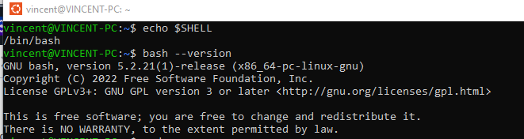

---

#### Screenshot 2 — Output of `pwd` and `ls -lah` showing the scripts directory

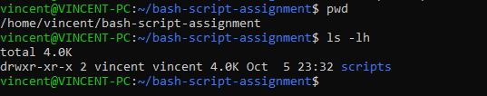

---

### Notes

Answer the following in your own words:

**1. What is Bash?**

Bash (Bourne Again Shell) is a command-line interpreter and scripting language used
on Linux, macOS, and many Unix-like systems. It evolved from the original Bourne Shell (sh) and adds modern features such as command history, arrays, etc.
---

**2. What is the difference between shell and Bash?**

A shell is the broad class of command interpreters whereas Bash is one specific shell among many others.

---

**3. Why is it important to confirm the Bash version before writing scripts?**

It is important to confirm the Bash version because different Bash versions support different features and using a feature unsupported by your system's Bash will break your script.

---

# Task 2 — Your First Bash Script

## Goal

Create your first Bash script, make it executable, and run it from the terminal.

### Evidence

#### Screenshot 1 — Content of `first-script.sh`

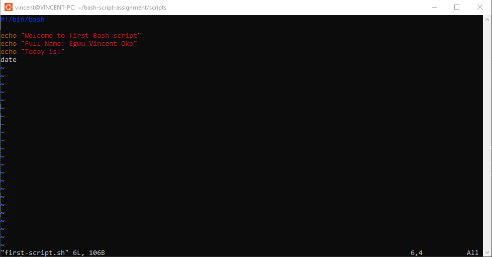

---

#### Screenshot 2 — Output of `./first-script.sh`

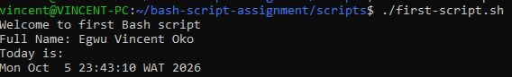

---

#### Screenshot 3 — Output of `ls -l first-script.sh` showing executable permission

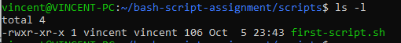

---

### Notes

Answer the following in your own words:

**1. What is the purpose of `#!/bin/bash`?**

The line #!/bin/bash at the top of a bash script is called shebang. It tells the operating system which program should interpret the file when it is run as an executable.

---

**2. Why do we use `chmod +x` before running a script?**

chmod +x gives the script 'execute permission', allowing it to run like a program.

---

**3. What is the difference between running a script using `./script.sh` and `bash script.sh`?**

When a script is run with './script.sh', the OS executes the file directly, the shebang determines the interpreter, and requires execute permission.

When a script is run with 'bash script.sh', the Bash interpreter is explicitly invoke without requiring execute permission, and shebang is ignored.

---

# Task 3 — Variables: User Information Script

## Goal

Use variables to store and display user-related information.

### Evidence

#### Screenshot 1 — Content of `user-info.sh`

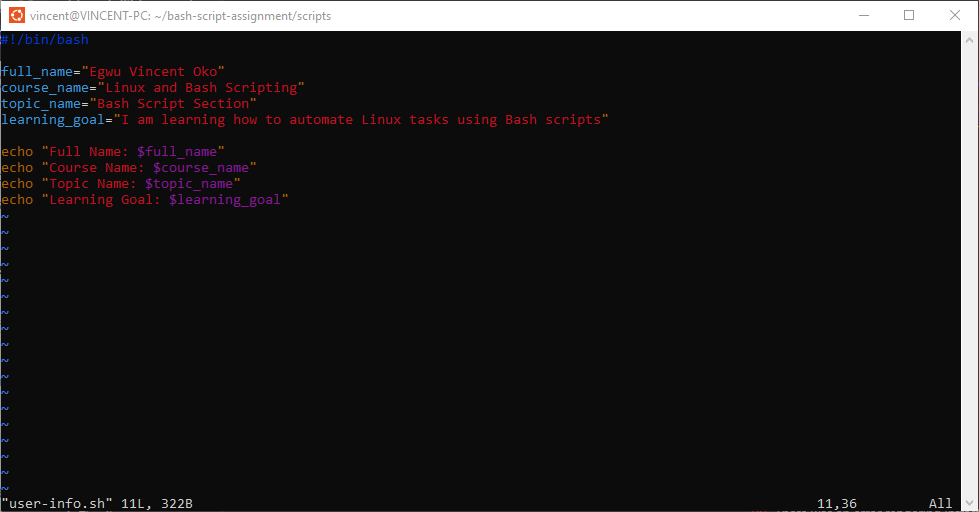

---

#### Screenshot 2 — Output of `./user-info.sh`

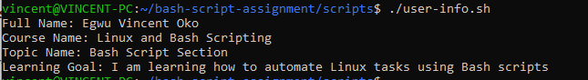

---

### Notes

Answer the following in your own words:

**1. What is a variable in Bash?**

A variable in Bash is a name that holds data, such as text, numbers, command output, or lists.

---

**2. Why should we avoid spaces around the `=` sign when creating variables?**

This is because Bash interprets spaces as separators between commands and arguments, and not as part of an assignment. Variable assignment in Bash is a special syntax, and spaces break that syntax. 

---

**3. How do you access the value stored inside a Bash variable?**

A value stored inside a Bash variable can be accessed by prefixing its name with a $.

---

# Task 4 — Arrays & Loops: Tools Checklist Script

## Goal

Use arrays and loops to print a checklist of tools used in Bash scripting.

### Evidence

#### Screenshot 1 — Content of `tools-checklist.sh`

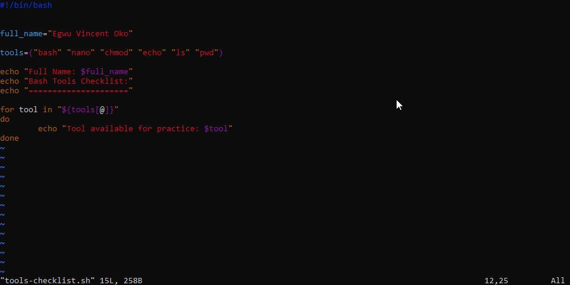

---

#### Screenshot 2 — Output of `./tools-checklist.sh`

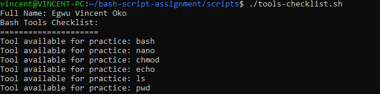

---

### Notes

Answer the following in your own words:

**1. What is an array in Bash?**

An array in Bash is a single variable that stores a list of values, each accessible by an index.

---

**2. Why are arrays useful in scripts?**

Arrays make scripts cleaner, more scalable, and easier to maintain

---

**3. What does `"${tools[@]}"` mean?**

`"${tools[@]}"` expands to all elements of the array, each as a separate word. This preserves spacing in elements, ensures correct iteration in loops, and avoids collapsing the array into a single string.

---

**4. What is the purpose of the `for` loop in this script?**

The 'for'loop makes it possible to repeat a block of code for each item in a list, array, or range. This is useful for automating repetitive tasks, processing lists of files, users, commands, or numbers.

---

# Task 5 — Loops: Number Counter Script

## Goal

Use loops to repeat a task multiple times.

### Evidence

#### Screenshot 1 — Content of `counter.sh`

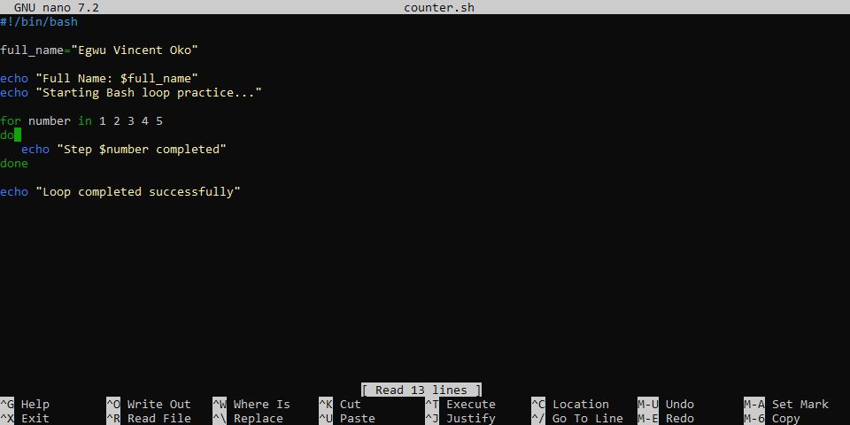

---

#### Screenshot 2 — Output of `./counter.sh`

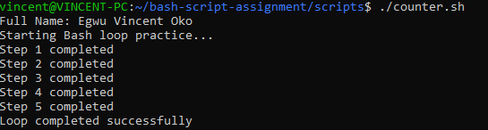

---

### Notes

Answer the following in your own words:

**1. What is a loop?**

A loop is a control structure that repeats a block of code until a condition is met or until it has iterated over a list of items.

---

**2. Why do we use loops in Bash scripting?**

Loops make scripts efficient, scalable, and easier to maintain. It is beneficial in automating repetitive tasks, processing lists, and making sscripts shorter and cleaner.

---

**3. How many times did the loop run in your script?**

The loop ran five (5) times

---

**4. What would you change if you wanted the loop to run 10 times?**

To run the loop for 10 times, increase the counter from 5 to 10.

That is, 'for number in 1 2 3 4 5 6 7 8 9 10'

---

# Task 6 — Files & Conditionals: File Validation Script

## Goal

Use file checks and conditionals to verify whether files and directories exist.

### Evidence

#### Screenshot 1 — Output of `ls -lah ../test-folder`

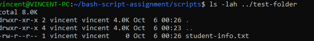

---

#### Screenshot 2 — Content of `file-check.sh`

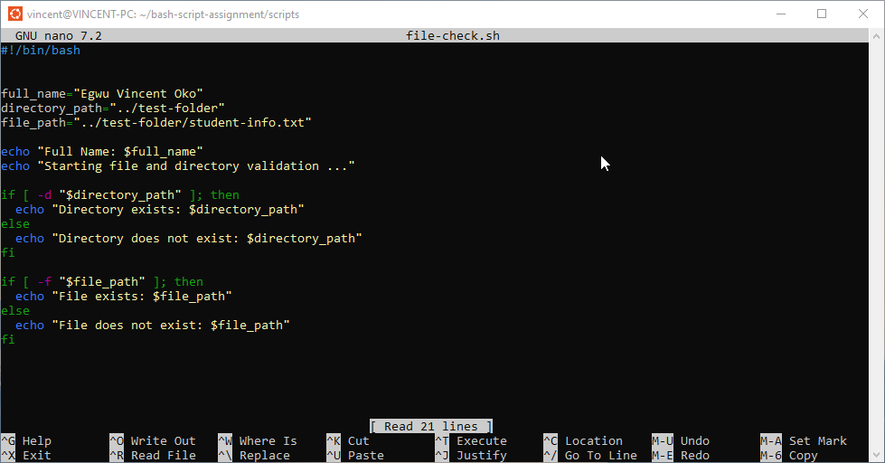

---

#### Screenshot 3 — Output of `./file-check.sh`

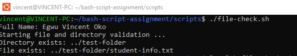

---

### Notes

Answer the following in your own words:

**1. What does `-d` check in Bash?**

'-d' checks whether a directory exists at the given path.

---

**2. What does `-f` check in Bash?**

'-f' checks whether a regular file exists at the given path.

---

**3. Why should file and directory paths be stored in variables?**

Storing file and directory paths in variables makes scriptscleaaner, safer, and easier to maintain. This avoids repetition and makes for better readability.

---

**4. What happens if the file does not exist?**

If the file does not exist, '-f' returns false, the if condition fails, and the script runs the else block (if present). 

---

# Task 7 — Conditionals: Pass or Retry Script

## Goal

Use if-else conditionals to make decisions based on a variable value.

### Evidence

#### Screenshot 1 — Content of `score-check.sh` with `score=85`

---

#### Screenshot 2 — Output showing `Result: Pass`

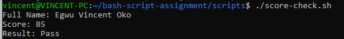

---

#### Screenshot 3 — Content of `score-check.sh` with `score=55`

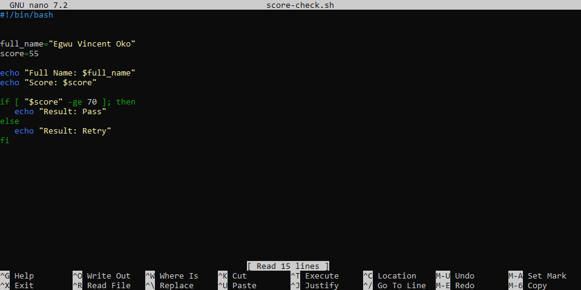

---

#### Screenshot 4 — Output showing `Result: Retry`

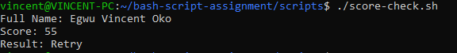

---

### Notes

Answer the following in your own words:

**1. What is the purpose of if-else in Bash?**

The 'if-else' structure in Bash allows your script to run different code depending on whether a condition is true or false. It enables branching logic, error handling, validating input, running alternative actions when something fails.

---

**2. What does `-ge` mean?**

'-ge' is a numeric comparison operator which means greater than or equal to.

---

**3. Why should conditions be tested with different values?**

Conditions should be tested with different values to ensure the script behaves correctly in all scenarios, not just the ideal scenario.

---

**4. How can conditionals help in automation scripts?**

Conditionals make automation smart instead of blindly repeating actions. They improve automation by skipping steps when files ordirectories are missing, validating user input before running commands, handling failures gracefully, and making scripts adaptable to different environments.

---

# Task 8 — Functions: Final Bash Automation Script

## Goal

Create a final Bash script using functions to organize reusable code.

### Evidence

#### Screenshot 1 — Content of `final-automation.sh`

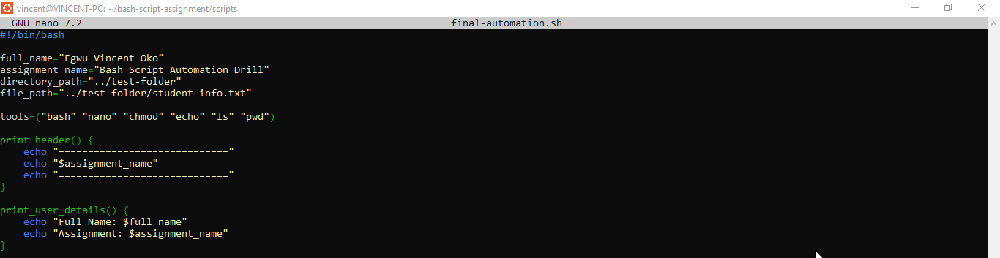

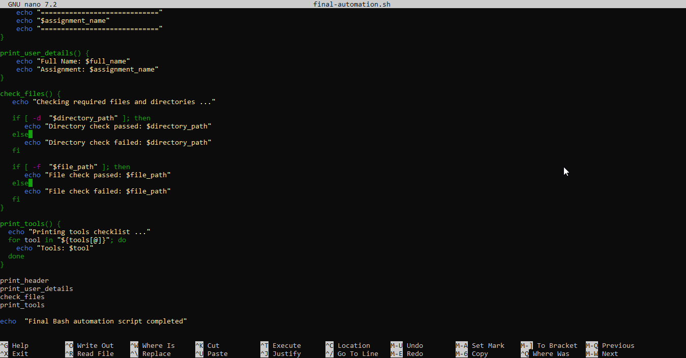

---

#### Screenshot 2 — Output of `./final-automation.sh`

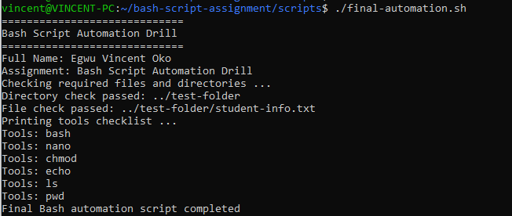

---

#### Screenshot 3 — Output of `ls -lah` showing all created scripts

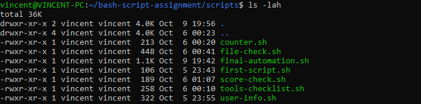

---

### Notes

Answer the following in your own words:

**1. What is a function in Bash?**

This is a named section of code that performs a specific task and can be called multiple times within a script.It helps organize logic, avoid repetition, and make the script modular.

---

**2. Why are functions useful in scripts?**

The benefits of functions include:
Reusability - write logic once,call it many times

Organization - break large scripts into readable sections

Error handling - isolate risky operations

Modularity - build scripts like building blocks

---

**3. Which functions did you create in this script?**

They are:
print_header,

print_user_details,

check_files,

print_tools

---

**4. How does this final script combine variables, arrays, loops, conditionals, files, and functions?**

A script combines variables, arrays, loops, conditionals, files, and functions by by using each feature for what it does best - variables store data, arrays hold lists, loops repeat actions, conditionals make decisions, file tests validate paths, and functions organize everything.

---

# LinkedIn Post (Required)

## Evidence

#### LinkedIn Post URL

Paste your LinkedIn post URL here:

`https://lnkd.in/p/ewB98aXb`

---

#### Screenshot — Published LinkedIn post

---

# Submission Instructions

- Add all required screenshots in your submission
- Full name must be visible in required screenshots
- All script files must be created and run successfully
- Required notes must be answered clearly for every task
- Do not expose sensitive information (keys, passwords, credentials)

---

# Completion Checklist

- [ ] Task 1: Environment setup verified, workspace created (Screenshots 1–2, Notes answered)
- [ ] Task 2: First script created, executed, permissions verified (Screenshots 1–3, Notes answered)
- [ ] Task 3: Variables script created and run (Screenshots 1–2, Notes answered)
- [ ] Task 4: Arrays and loops script created and run (Screenshots 1–2, Notes answered)
- [ ] Task 5: Counter loop script created and run (Screenshots 1–2, Notes answered)
- [ ] Task 6: File validation script created and run (Screenshots 1–3, Notes answered)
- [ ] Task 7: Pass/Retry conditional script tested with both values (Screenshots 1–4, Notes answered)
- [ ] Task 8: Final automation script created and run (Screenshots 1–3, Notes answered)
- [ ] All scripts run without errors
- [ ] Full Name visible in all required screenshots
- [ ] LinkedIn post published and URL submitted
- [ ] No sensitive data exposed

---

## 📌 About DMI & CloudAdvisory

DevOps Micro Internship (DMI) is a project-based DevOps program run by Pravin Mishra (The CloudAdvisory) focused on real-world execution, systems thinking, and career readiness.

It helps learners build strong DevOps foundations with hands-on experience.

---

## 📌 Resources

- 🌐 DMI Official Website: https://dmi.pravinmishra.com?utm_source=github&utm_medium=readme  
- 🎓 University: https://university.pravinmishra.com?utm_source=github&utm_medium=readme  
- 💬 Discord Community: https://discord.pravinmishra.com?utm_source=github&utm_medium=readme  
- 📝 Blog: https://dmi.pravinmishra.com/blog?utm_source=github&utm_medium=readme  
- ▶️ YouTube Playlist: https://www.youtube.com/playlist?list=PLFeSNDtI4Cho  
- 🔗 Pravin Mishra (LinkedIn): https://www.linkedin.com/in/pravin-mishra-aws-trainer/  
- 🏢 CloudAdvisory (LinkedIn): https://www.linkedin.com/company/thecloudadvisory/

---

*This submission is part of DevOps Micro Internship (DMI) Cohort 3 — Agentic AI Track.*