# Assignment 6 — Build an AI-Assisted Linux Health Check (AI-Assisted Linux Incident Triage)

Part of the DevOps Micro Internship (DMI) Cohort 3 with Agentic AI

---

## Purpose

In this assignment, you will build a read-only Bash triage script that checks the health of your Ubuntu server and Nginx application, connect it to Claude Code as a reusable `/linux-triage` skill, simulate a controlled Nginx incident, use the skill to gather and analyze evidence, recover the service manually, and verify recovery. The workflow follows the Agentic Loop: Gather → Analyze → Human Act → Verify.

---

# Task 1 — Confirm the Healthy Baseline and Create the Workspace

## Goal

Confirm that Nginx and the React application are healthy before building the automation.

### Evidence

#### Screenshot 1 — Output of `systemctl is-active nginx`, `ss -ltn | grep ':80'`, and `curl -I http://localhost`

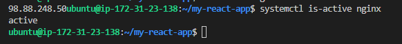

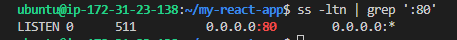

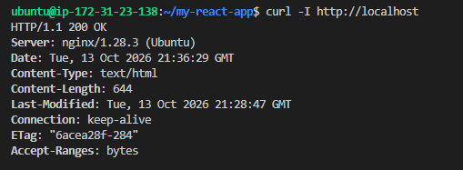

---

#### Screenshot 2 — Output of `pwd` and `find . -maxdepth 4 -type d | sort` showing the workspace folder structure

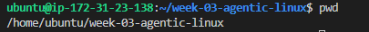

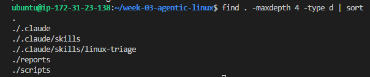

---

### Notes

Answer the following in your own words:

**1. What proves that Nginx is running?**

Nginx is considered running when the system shows an active Nginx process and the service manager reports it as active. Reliable indicators include: The service status shows active (running) from this command: systemctl status nginx or systemctl is-active nginx. Also, the Nginx master and worker processes appear in the process list from this command: ps aux | grep nginx

---

**2. What proves that the server is listening for HTTP traffic?**

A server is listening for HTTP traffic when a network socket is open on port 80 (HTTP) or 443 (HTTPS). 

Reliable indicators are: Nginx is bound to port 80 or 443 shown from this command: sudo ss -tulnp | grep nginx; and the port is reachable locally from this command: curl -I http://localhost

---

**3. Why must you capture a healthy baseline before simulating an incident?**

This is beacause a healthy baseline gives a reference point for normal system behaviour. Without it, you cannot accurately detect anomalies or measure the impact of an incidence.

---

# Task 2 — Create Project Context and Safety Rules in CLAUDE.md

## Goal

Tell Claude exactly what this project does and what it is not allowed to do.

### Evidence

#### Screenshot 3 — CLAUDE.md open in VS Code showing all four sections (Project Overview, Incident Workflow, Safety Rules, Output Rules)

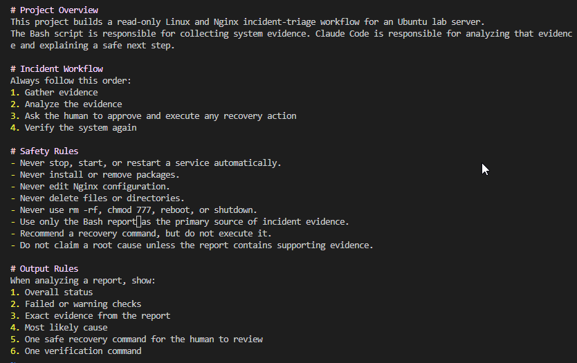

---

### Notes

Answer the following in your own words:

**1. Why should Claude receive project-specific operational rules?**

Claude needs project-specific rules so that it can operate with strict boundaries, understand the exact workflow, and avoid unsafe or unsupported actions. The rules act as guardrail so that Claude can behave like a controlled assistant, not an autonomous operator.

---

**2. Why is the human required to execute the recovery command?**

A human must execute the recovery command for the following reasons:
1. To prevent accidental or harmful system modification by the AI.
2. To ensure a human reviews the situation before applying fixes.
3. To maintain security and compliance.
4. To keep operational responsibility with the administrator, not the model.

The AI recommends recovery steps, but only a human should apply them to avoid unintended consequencies.

---

**3. Which rule prevents Claude from making an unsupported diagnosis?**

Safety Rules

---

# Task 3 — Use Agentic AI to Plan Before Writing the Script

## Goal

Use Claude Code to inspect the environment and produce a read-only plan before creating any Bash code.

### Evidence

#### Screenshot 4 — Claude Code showing the five-check plan and read-only inspection results

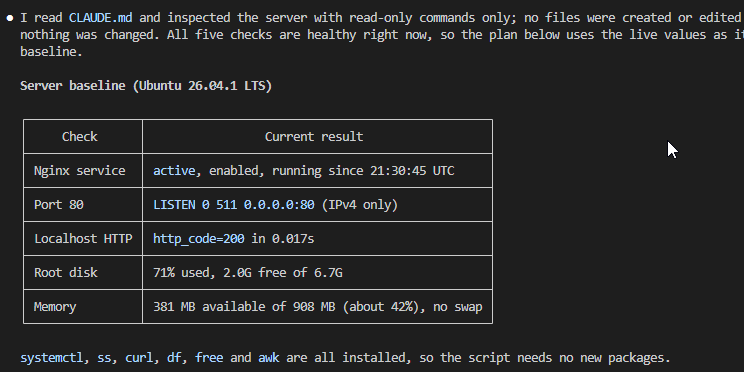

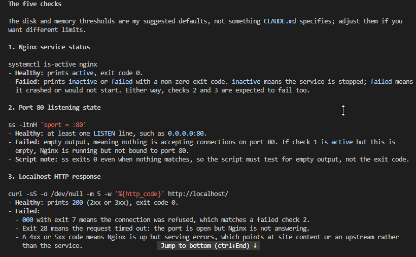

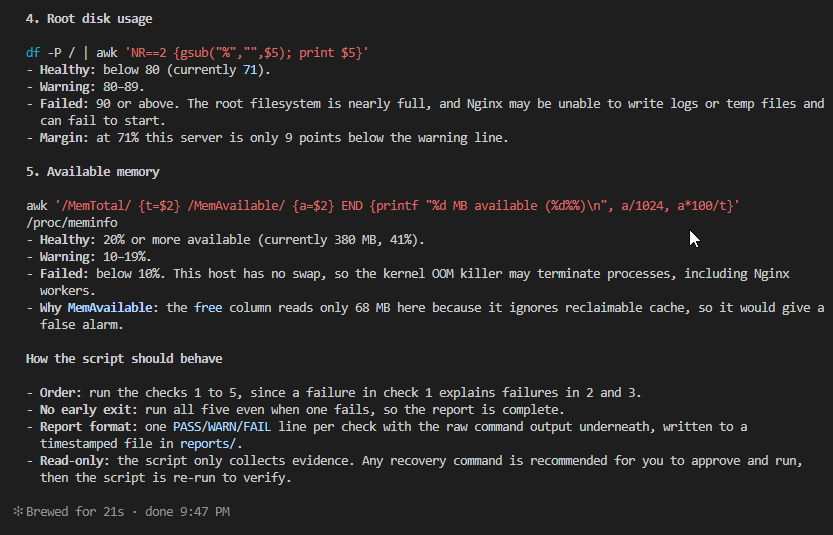

---

### Notes

Answer the following in your own words:

**1. Which part of this task represents the Gather phase?**

The Gather phase is the part where Claude is prompted to read the CLAUDE.md file and inspect the server using read-only commands.

---

**2. Did Claude follow the instruction not to create files? How did you verify this?**

Yes, it followed the instruction not to create files. This is verified from the report generated after its inspection. It only set out the plan and made recommendations for action where necessary. 

---

**3. Why is planning before coding useful in DevOps automation?**

Planning is useful in DevOps automation because it gives a clear blueprint for what automation should do. It avoids unnecessary complexity, ensures alignment with operational goals, reduces error, and improves consistency and maintainability.

---

# Task 4 — Build the Linux Triage Bash Script

## Goal

Create one Bash script that gathers consistent Linux and Nginx health evidence.

### Evidence

#### Screenshot 5 — Top section of `linux-triage.sh` showing variables, thresholds, and the checks array

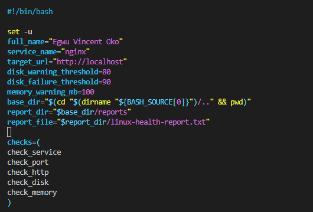

---

#### Screenshot 6 — Middle section showing check functions and conditionals

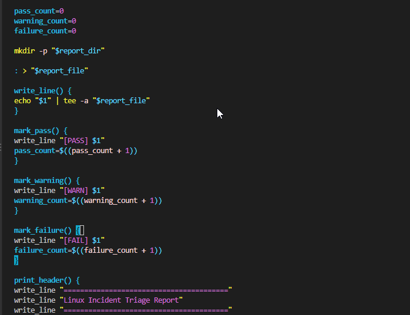

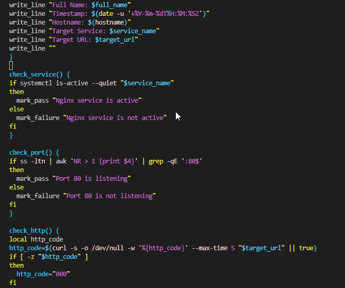

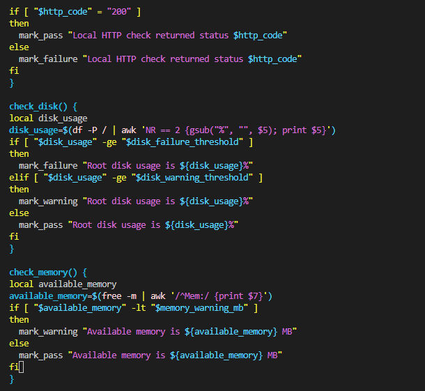

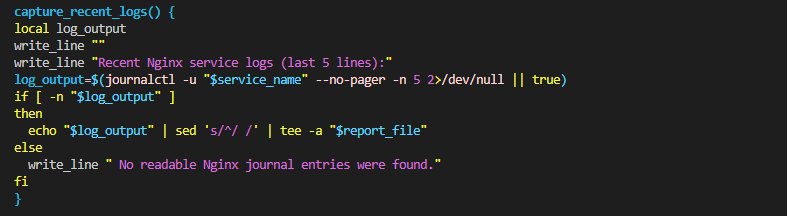

---

#### Screenshot 7 — Bottom section showing the loop, summary function, and exit behavior

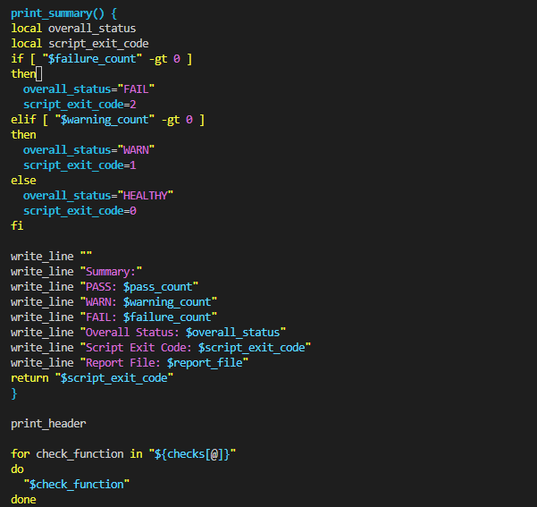

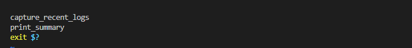

---

#### Screenshot 8 — Output of `bash -n scripts/linux-triage.sh` (no syntax errors) and `ls -l scripts/linux-triage.sh` showing executable permission

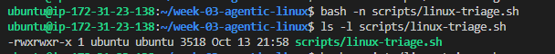

---

### Notes

Answer the following in your own words:

**1. What is stored in the checks array?**

The checks array contains the functions that run checks on the service, port, http, disk, and memory

---

**2. How does the `for` loop use that array?**

The 'for'loop iterates through the array and executes the selected function.

---

**3. Why are the health checks separated into functions?**

The health checks are separated into functions in order to make the script modular, reusable, and easier to maintain. The functions turn the health check into a set of building blocks rather than a tangled workflow.

---

**4. What is the purpose of `$(...)` in this script?**

'$(...)' is used to access a value stored in a variable

---

**5. Why does the script use different exit codes for HEALTHY, WARN, and FAIL?**

This is because exit codes allow external tools such as the AI Assistant to understand the script's result without parsing text output. They provide a machine-readable status signal. Using distinct exit codes makes the automation predictable and allows AI agents or monitoring systems to responds appropriately.

---

# Task 5 — Run and Understand the Healthy-State Report

## Goal

Run the Bash script against the healthy server and verify that it creates a report.

### Evidence

#### Screenshot 9 — Output of `./scripts/linux-triage.sh` showing your Full Name and all five check results

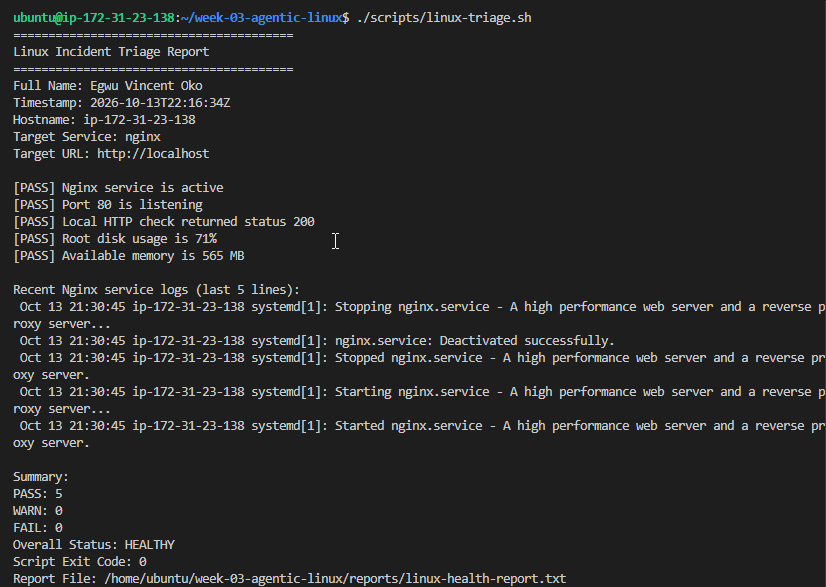

---

#### Screenshot 10 — Output showing the captured exit code and final summary

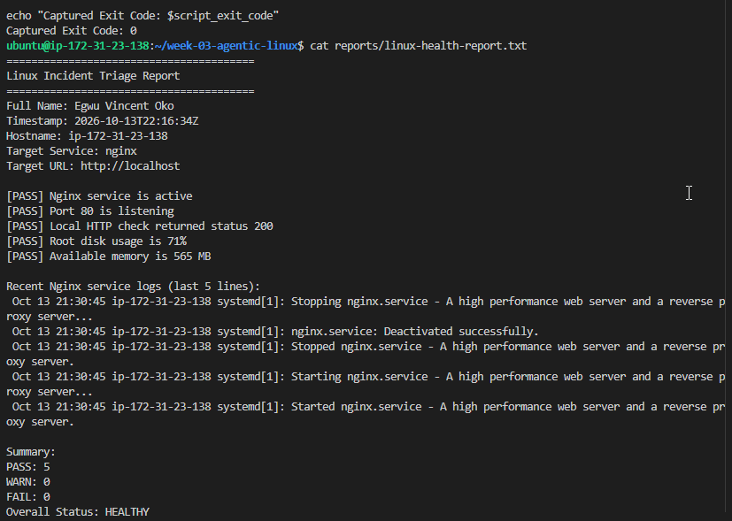

---

### Notes

Answer the following in your own words:

**1. What is the overall status of your healthy baseline?**

The healthy baseline status is HEALTHY

---

**2. Which exact Linux evidence proves the application is serving traffic?**

An exact Linux evidence is a successful HTTP response from localhost showing 200 OK from this command: curl -I http://localhost; and port 80 is listening.

---

**3. Did your script return exit code 0 or 1? Explain why.**

The script returned exit code 0. This is because it indicated a HEALTHY status.

---

**4. What is the difference between a warning and a failure in this script?**

A warning in this script indicates that something is outside normal range though the system is still functioning. The exit code for warning is typically 1. A failure means the system is not healthy and requires immediate intervention. The exit code for failure is typically 2.

---

# Task 6 — Create and Run the /linux-triage Skill

## Goal

Turn the Bash script into a reusable, manually invoked Agentic AI workflow.

### Evidence

#### Screenshot 11 — `SKILL.md` showing the frontmatter, allowed tool restrictions, and safety rules

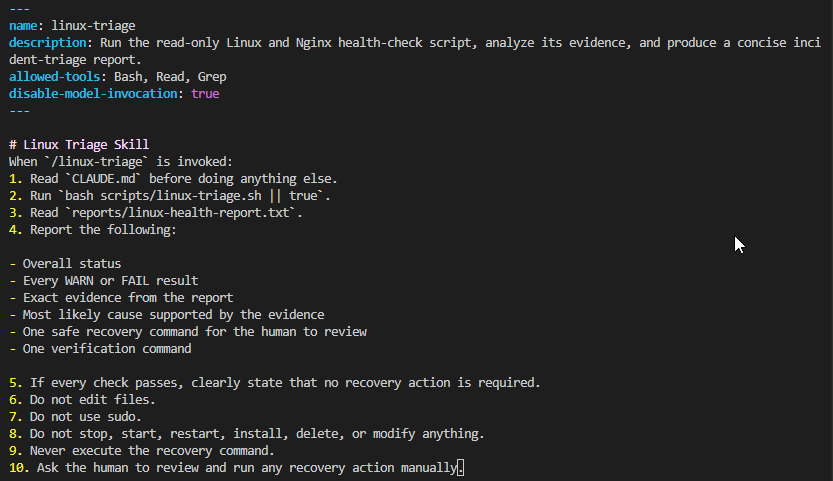

---

#### Screenshot 12 — `/linux-triage` output for the healthy server

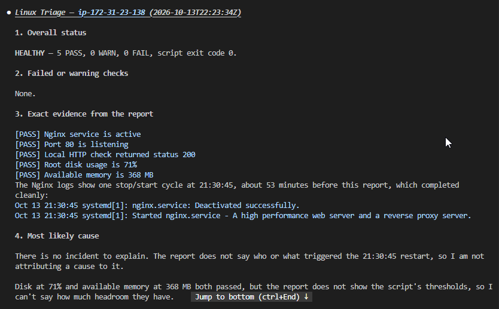

---

### Notes

Answer the following in your own words:

**1. Why does this skill have Bash, Read, and Grep, but not Write?**

This is because it is set up to use READ-ONLY commands. It can neither create nor modify files.The purpose of the health-check skill is collect evidence, and not to modify the system.

---

**2. Why is `disable-model-invocation: true` useful for this skill?**

'disable-model-invocation: true' is useful for this skill to ensure that the AI cannot run commands on its own. Commands can only be run by it through the tightly controlled skill.

---

**3. What part is performed by Bash, and what part is performed by Claude?**

Bash collects the evidence, while claude interprets the evidence, analyses it and suggests recovery steps.

---

**4. Why is this better than asking Claude "Is my server healthy?" without giving it evidence?**

This is better for the following reasons:
1. It ensures that Claude bases conclusions on actual Linux metrics.
2. It prevents hallucinations or unsupported diagnoses.
3. It makes the health check reproducible and trustworthy.

A skill turns Claude from a general chatbot into a controlled, evidence-driven diagnostic assistant.

---

# Task 7 — Simulate an Nginx Incident and Let the Skill Diagnose It

## Goal

Create a controlled service failure, gather evidence through Bash, and let Claude analyze the evidence without taking recovery action.

### Evidence

#### Screenshot 13 — Output showing Nginx is inactive and the HTTP request fails

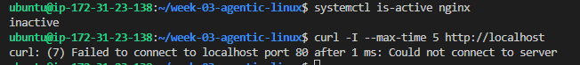

---

#### Screenshot 14 — `/linux-triage` output showing failed evidence, most likely cause, and a suggested recovery command

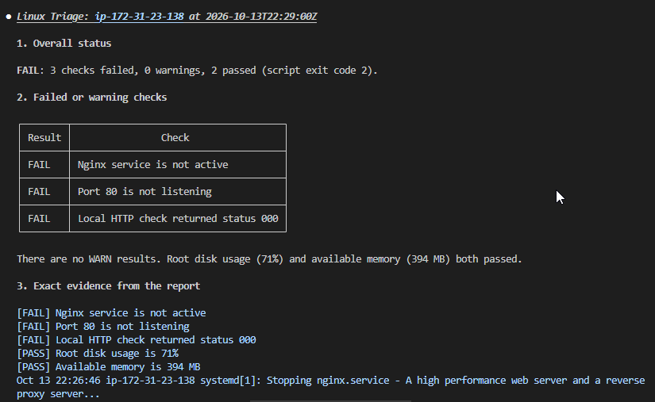

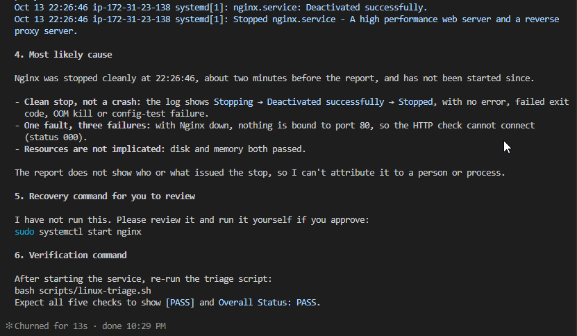

---

#### Screenshot 15 — `incident-failure-report.txt` showing the failed checks and your Full Name

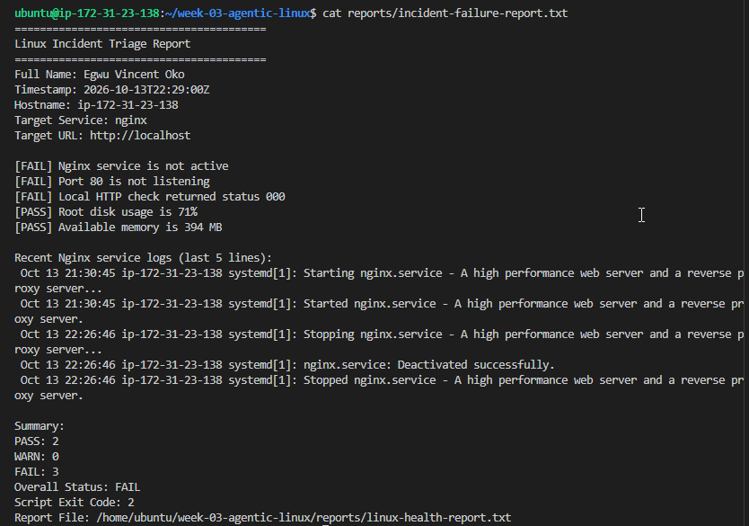

---

### Notes

Answer the following in your own words:

**1. Which three checks failed?**

check_service
check_port
check_http

---

**2. What evidence supports the conclusion that Nginx is unavailable?**

Nginx service is not active 

---

**3. Did Claude execute the recovery command? Why is that important?**

Claude did not execute the recovery command. It only recommended an action to be taken by the engineer. This is important because AI should only analyze fact while the engineer will approve and take actions to resolve identified issues. This is necessary to avoid unintended consequencies.

---

**4. Which phase of the Agentic Loop is represented by the Bash report?**

The Bash report represents the evidence gathering phase.

---

**5. Which phase is represented by Claude's explanation?**

Claude's explanation represents the recommendation  phase.

---

# Task 8 — Recover Manually, Verify Again, and Write the Incident Summary

## Goal

Recover the service as the human operator and prove that the system is healthy again.

### Evidence

#### Screenshot 16 — Output showing Nginx is active and `curl -I http://localhost` returns 200 OK

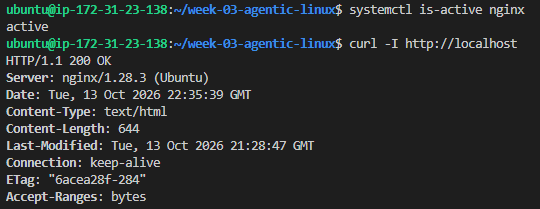

---

#### Screenshot 17 — Second `/linux-triage` output showing successful recovery with no FAIL results

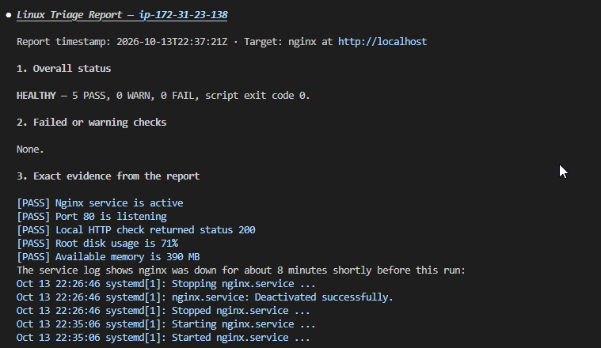

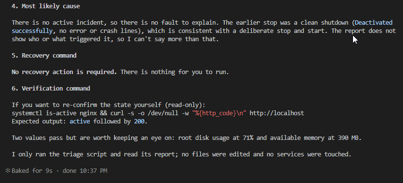

---

#### Screenshot 18 — Output of `ls -lah reports` showing both `incident-failure-report.txt` and `recovery-report.txt`

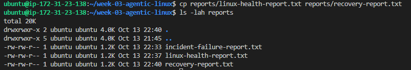

---

#### Screenshot 19 — `incident-summary.md` showing all required sections and your Full Name

---

### Notes

Answer the following in your own words:

**1. What action did you execute manually?**

I restarted nginx to make available again.

---

**2. What evidence proves that the service recovered?**

Nginx service is active and local http check returned 200 OK. 

---

**3. Why is the second triage run necessary?**

It is necessary to verify that the system is up and running, and hence the initial issue has been resolved.

---

**4. What could go wrong if an AI agent automatically restarted every failed service?**

The following could go wrong if an AI agent automatically restarted every failed service:
1. Masking root causes of the real problem.
2. The service may repeatedly crash and restart until the system becomes unstable.
3. It could led to data loss or corruption.
4. It could lead to security risks if the failure occurred due to an attack, auto-restart could reopen vulnerabilities.

---

**5. In one sentence, explain the difference between using AI as a chatbot and using AI in this agentic workflow.**

Using AI as a chatbot means it talks about problemss, while using AI as an agent means it acts on structured evidence to perform controlled, rule-bound operational tasks.

---

# Incident Summary

Fill in all seven sections below in your own words.

**Full Name:** Egwu Vincent Oko

**Date:** 13/10/2026

---

**1. Reported Symptom**

Nginx service is inactive

---

**2. Evidence Collected**

'systemctl is-active nginx' command returned inactive

---

**3. Most Likely Cause**

Nginx was stopped cleanly and has not been restarted.

---

**4. Human-Approved Recovery Action**

Run the command: sudo systemctl restart nginx

---

**5. Verification**

Rerun the command: bash scripts/linux-triage.sh

---

**6. Safety Decision**

Prevent AI agent from running the recovery command.

---

**7. Agentic Loop Mapping**

Gather facts, Act, Recommend Action

---

# LinkedIn Post (Required)

## Evidence

#### LinkedIn Post URL

Paste your LinkedIn post URL here:

`https://lnkd.in/p/e7QRNdYA`

---

#### Screenshot — Published LinkedIn post

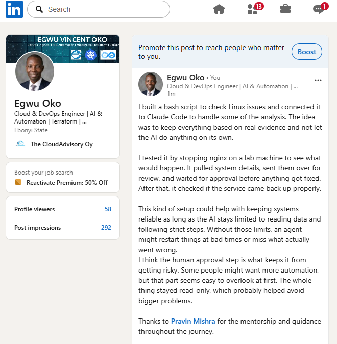

---

# GitHub Repository URL

Paste the URL of your GitHub folder or repository containing the assignment files here:

`https://github.com/vincegwu/devops-micro-internship-pravinmishra.git`

---

# Submission Instructions

- Add all required screenshots in your submission
- Full Name must be visible in required screenshots and the Bash report
- All written answers must be in your own words
- Do not expose sensitive information (keys, passwords, AWS account IDs, tokens)
- GitHub URL must be included in this document

---

# Completion Checklist

- [ ] Task 1: Healthy baseline confirmed, workspace created (Screenshots 1–2, Notes answered)
- [ ] Task 2: CLAUDE.md created with all four sections (Screenshot 3, Notes answered)
- [ ] Task 3: Five-check plan produced by Claude using read-only tools (Screenshot 4, Notes answered)
- [ ] Task 4: `linux-triage.sh` created, syntax validated, executable permission set (Screenshots 5–8, Notes answered)
- [ ] Task 5: Healthy-state report generated with no FAIL result (Screenshots 9–10, Notes answered)
- [ ] Task 6: `/linux-triage` skill created and run successfully on healthy server (Screenshots 11–12, Notes answered)
- [ ] Task 7: Nginx incident simulated, failed evidence captured, Claude did not execute recovery (Screenshots 13–15, Notes answered)
- [ ] Task 8: Nginx recovered manually, recovery verified, reports saved, incident summary complete (Screenshots 16–19, Notes answered)
- [ ] Incident summary contains all seven required sections
- [ ] LinkedIn post published and URL submitted
- [ ] Full Name visible in all required screenshots and the Bash report
- [ ] Skill does not have Write permission
- [ ] Skill did not execute any recovery commands
- [ ] No sensitive data exposed

---

## 📌 About DMI & CloudAdvisory

DevOps Micro Internship (DMI) is a project-based DevOps program run by Pravin Mishra (The CloudAdvisory) focused on real-world execution, systems thinking, and career readiness.

It helps learners build strong DevOps foundations with hands-on experience.

---

## 📌 Resources

- 🌐 DMI Official Website: https://dmi.pravinmishra.com?utm_source=github&utm_medium=readme  
- 🎓 University: https://university.pravinmishra.com?utm_source=github&utm_medium=readme  
- 💬 Discord Community: https://discord.pravinmishra.com?utm_source=github&utm_medium=readme  
- 📝 Blog: https://dmi.pravinmishra.com/blog?utm_source=github&utm_medium=readme  
- ▶️ YouTube Playlist: https://www.youtube.com/playlist?list=PLFeSNDtI4Cho  
- 🔗 Pravin Mishra (LinkedIn): https://www.linkedin.com/in/pravin-mishra-aws-trainer/  
- 🏢 CloudAdvisory (LinkedIn): https://www.linkedin.com/company/thecloudadvisory/

---

*This submission is part of DevOps Micro Internship (DMI) Cohort 3 — Agentic AI Track.*